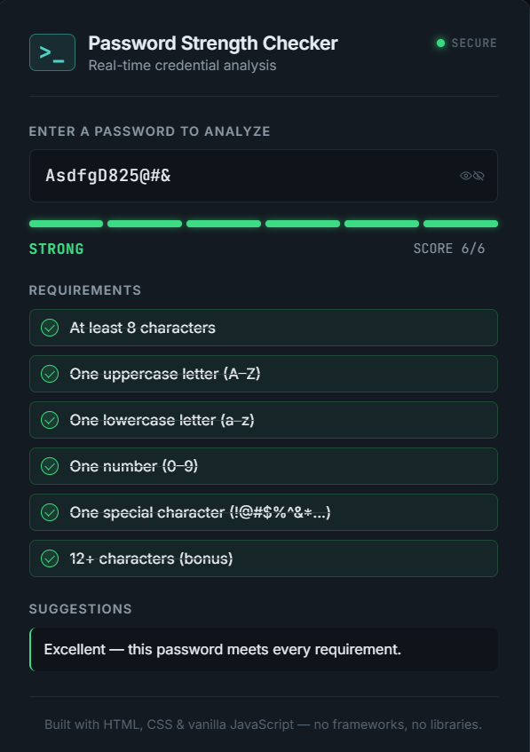

# Password Strength Checker

A real-time password strength analyzer built with plain HTML, CSS, and JavaScript — no frameworks, no build tools, no dependencies. Type a password and get instant feedback: a strength rating, a segmented strength meter, a live requirements checklist, and specific suggestions for improvement.

**[Live Demo](https://itsyouness.github.io/password-strength-checker/)** *(will go live once you enable GitHub Pages — see "Deploying it" below)*


*(add a screenshot of the running app here)*

---

## Why this project

Most "password strength" widgets are a black box: you type, a bar changes color, and that's it. This project is built to be the opposite — every rule that contributes to the score is visible, labeled, and testable, and the code is organized so someone reading it for the first time can follow exactly how a password turns into a rating.

## Features

- **Real-time analysis** — no submit button, feedback updates on every keystroke.
- **Strength meter** — a 6-segment gauge that fills and changes color (red → amber → green) as the password improves.
- **Weak / Medium / Strong rating** with a live numeric score (e.g. `SCORE 4/6`).
- **Requirements checklist** — each rule ticks off individually as it's satisfied.
- **Show/hide password** toggle with proper `aria-pressed` state for accessibility.
- **Contextual suggestions** — only tells you what's *actually* missing, and confirms once everything is met.
- **Fully responsive**, keyboard-accessible, and respects `prefers-reduced-motion`.

## How scoring works

The checker evaluates a password against six rules:

| Rule | Description |
|---|---|
| `length` | At least 8 characters (treated as a hard minimum) |
| `uppercase` | Contains an uppercase letter (A–Z) |
| `lowercase` | Contains a lowercase letter (a–z) |
| `number` | Contains a digit (0–9) |
| `special` | Contains a non-alphanumeric character |
| `longLength` | Bonus point for 12+ characters |

Each rule met adds one point to the score (0–6 total). The overall rating is:

- **0–2 points → Weak**
- **3–4 points → Medium**
- **5–6 points → Strong**

A password shorter than 8 characters is always capped at **Weak**, regardless of how many other rules it satisfies — length is the single biggest factor in resisting brute-force attacks, so the app treats it as a floor rather than just one point among several.

This logic lives in a single pure function, `evaluate(password)`, in `js/script.js`. It takes a string and returns a score/level object — it doesn't touch the DOM at all, which makes it easy to test on its own or reuse in a different UI later.

## Tech stack

- **HTML5** — semantic structure, accessible labeling (`aria-live`, `aria-pressed`, `aria-describedby`)
- **CSS3** — custom properties (design tokens), CSS Grid/Flexbox layout, transitions, no framework
- **JavaScript (ES6)** — `const`/`let`, arrow functions, template literals, array methods, no libraries

## Project structure

```
password-strength-checker/
├── index.html          # Structure & markup
├── css/
│   └── style.css        # Design tokens, layout, responsive rules
├── js/
│   └── script.js         # Rule definitions, scoring logic, DOM rendering
└── README.md
```

## Running it locally

No build step required.

```bash
git clone https://github.com/itsyouness/password-strength-checker.git
cd password-strength-checker
open index.html   # or just double-click the file
```

Or serve it locally (recommended, avoids some browser file:// restrictions):

```bash
npx serve .
# or
python3 -m http.server 8000
```

## Deploying it (for the live demo link above)

The easiest option is GitHub Pages:

1. Push this repo to GitHub.
2. Go to **Settings → Pages**.
3. Under "Build and deployment", set **Source** to `Deploy from a branch`, pick `main` and `/ (root)`.
4. Your site will be live at `https://itsyouness.github.io/password-strength-checker/`.

## What I practiced building this

- Writing DOM-manipulation logic that's decoupled from the "business logic" (scoring), so each part can be reasoned about — and tested — independently.
- Using CSS custom properties as a lightweight design-token system instead of hardcoding colors everywhere.
- Basic accessibility: focus states, `aria-live` regions for dynamic content, and a properly labeled show/hide toggle.
- Git workflow: incremental commits (structure → styling → logic → polish) instead of one giant commit.

## Possible extensions

- Add a "time to crack" estimate using entropy calculations.
- Check against a list of common leaked passwords.
- Add unit tests for `evaluate()` with a small test runner.
- Persist a dark/light theme toggle.

## License

MIT — feel free to use this as a learning reference or a starting point for your own version.
